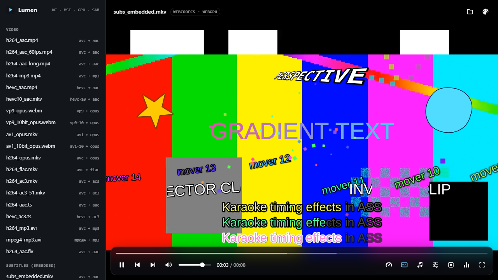
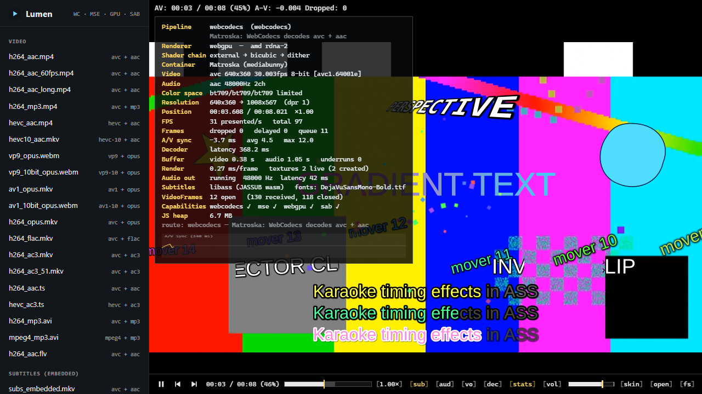
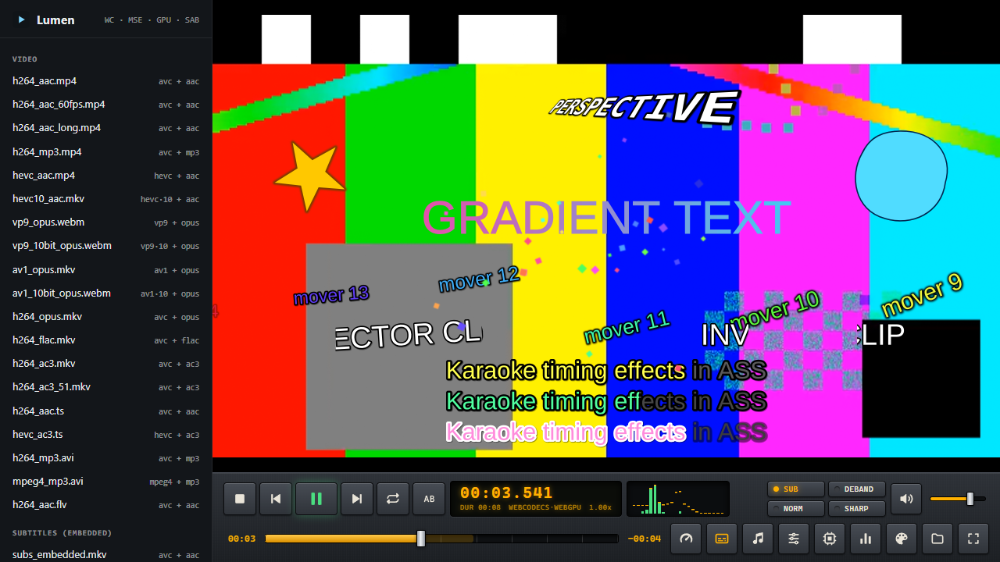

<div align="center">

# Lumen Player

**A powerful video player that runs entirely in your web browser.**

**English** · [简体中文](docs/i18n/README.zh-CN.md) · [日本語](docs/i18n/README.ja.md) · [한국어](docs/i18n/README.ko.md) · [Español](docs/i18n/README.es.md) · [Français](docs/i18n/README.fr.md) · [Português](docs/i18n/README.pt-BR.md) · [Русский](docs/i18n/README.ru.md) · [العربية](docs/i18n/README.ar.md) · [हिन्दी](docs/i18n/README.hi.md)



</div>

## What is Lumen?

Lumen is a media player you open in a browser tab. Think of a desktop player such as mpv or VLC,
rebuilt with modern web technology. Your files never leave your computer: everything is decoded
and displayed locally, in the page.

What it can do:

- **Play almost anything.** MP4, MKV, WebM, MPEG-TS, AVI and FLV files; H.264, HEVC, VP9, AV1 and
  older video; AAC, Opus, MP3, AC-3 and FLAC audio. When the browser cannot decode a file by
  itself, Lumen falls back to a built-in copy of FFmpeg.
- **Stay smooth and in sync.** Video is decoded by your graphics hardware where possible and drawn
  with the GPU, and picture is locked to sound to within a few milliseconds.
- **Show subtitles properly.** Styled ASS/SSA subtitles (the kind used for anime and karaoke),
  SRT, WebVTT and Blu-ray PGS, including subtitle tracks and fonts stored inside MKV files.
- **Change its look.** Three built-in skins, and you can make your own with a small JSON file.
- **Be driven from the keyboard.** The same shortcuts as mpv: frame-by-frame stepping, speed
  control, subtitle delay, A-B loop and more.
- **Show what is going on inside.** Press `i` for a live "stats for nerds" panel.

| Modern Glass | mpv OSC (with stats) | Studio Deck |
| --- | --- | --- |
|  |  |  |

## Before you start

You need three things installed:

1. **Node.js 22 or newer** (20.19+ also works) — get it from [nodejs.org](https://nodejs.org).
   To check, open a terminal and run `node --version`.
2. **Git** — get it from [git-scm.com](https://git-scm.com).
3. **Microsoft Edge or Google Chrome**, a recent version. Lumen relies on new browser features
   (WebCodecs, WebGPU), and these two are the browsers it is tested with.

You also need about 500 MB of free disk space for the dependencies and sample videos.

## Get started

Open a terminal (on Windows: PowerShell or Windows Terminal) and run these commands one at a time.

**1. Download the code**

```bash
git clone https://github.com/manb0fish/lumen-web-player.git
```

```bash
cd lumen-web-player
```

**2. Install the dependencies** (takes a minute or two)

```bash
npm install
```

**3. Create the sample videos** (optional, but it gives you something to play right away)

```bash
npm run media
```

This generates about 30 short test clips on your computer. Nothing is downloaded.

**4. Start the player**

```bash
npm run dev
```

Now open **<http://127.0.0.1:5173>** in Edge or Chrome. You should see the player with a list of
sample clips on the left. Click any of them to play it.

To stop the player, go back to the terminal and press `Ctrl+C`.

## Using the player

- **Play your own file:** drag it onto the player, or click the folder icon.
- **Add subtitles:** drag a `.ass`, `.srt`, `.vtt` or `.sup` file onto the player. Subtitles inside
  MKV files are found automatically; pick one from the subtitles menu.
- **Change the skin:** click the palette icon, or press `K`.
- **Change picture quality options:** the sliders icon opens renderer, scaler and filter settings.
- **See technical details:** press `i`.

### Handy keyboard shortcuts

| Key | What it does |
| --- | --- |
| `Space` | Play / pause |
| `←` `→` | Jump 5 seconds back / forward |
| `,` `.` | Step one frame back / forward |
| `[` `]` | Slow down / speed up |
| `9` `0` | Volume down / up |
| `m` | Mute |
| `z` `x` | Make subtitles appear earlier / later |
| `v` | Show / hide subtitles |
| `l` | Loop between two points (press at A, press at B, press again to clear) |
| `f` | Fullscreen |
| `K` | Next skin |
| `i` | Stats for nerds |

The full list, and how to change the shortcuts, is in the [guide](docs/GUIDE.md#keyboard-shortcuts).

## Common problems

**`npm run media` says ffmpeg is missing.**
The ffmpeg helper could not run its installer. Run these two commands, then try again:

```bash
npm install-scripts approve ffmpeg-static
```

```bash
npm rebuild ffmpeg-static
```

If the first command reports an unknown command, your npm is an older version that does not
need it: just run the second one.

**The sample list is empty.**
Run `npm run media`, then reload the page.

**The page does not load.**
Make sure `npm run dev` is still running in the terminal, and that the address is exactly
`http://127.0.0.1:5173`.

**I see "Audio is blocked by the browser".**
Browsers do not let pages start sound on their own. Click the player once and press play.

**It does not work in Firefox or Safari.**
Use Microsoft Edge or Google Chrome for now. Those are the browsers Lumen is built and tested on.

**A file will not play.**
Press `i` to see which decoder was chosen and why. One known gap: AV1 video cannot be decoded by
the built-in FFmpeg, so it needs a browser that supports AV1 itself (current Edge and Chrome do).

## For developers

Lumen is also a library: a headless player core with an optional user interface on top.

```ts
import { Player, mountUI } from './src';

const player = new Player({ container });
mountUI(player, container, { skin: 'glass' });
await player.load(fileOrUrl, { autoplay: true });
player.command('seek 30 absolute');
```

Run the checks:

```bash
npm run lint
```

```bash
npm test
```

Where to read more:

- [Guide](docs/GUIDE.md) — URL options, all shortcuts, embedding, writing skins, the test suite.
- [Architecture](docs/ARCHITECTURE.md) — how decoding, rendering, audio sync and subtitles work,
  and the trade-offs behind them.
- [Verification](docs/VERIFICATION.md) — what the 163 automated tests measure, and the results.

## Authors

- [manb0fish](https://github.com/manb0fish)
- [Claude](https://claude.com/claude-code), Anthropic's AI model — co-author of the code, tests
  and documentation

## License

Lumen Player is free software, released under the [GNU General Public License v3.0](LICENSE).

It builds on other open-source projects that keep their own licenses, including
[FFmpeg](https://ffmpeg.org) (through `@ffmpeg/core`, GPL), [libass](https://github.com/libass/libass)
(through JASSUB, LGPL and others) and [Mediabunny](https://mediabunny.dev) (MPL-2.0).
